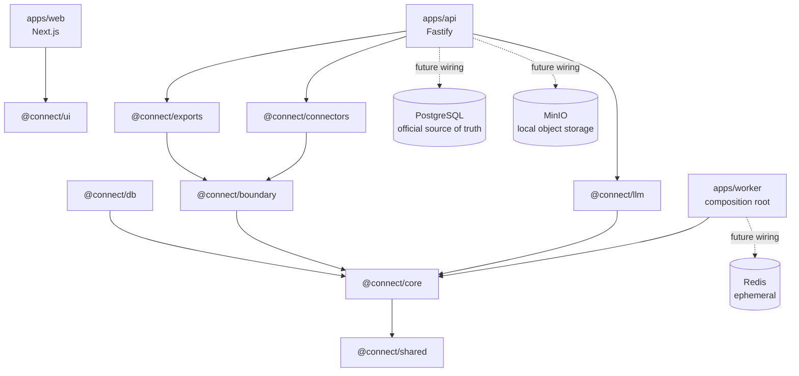

# Foundation architecture

Applications are composition roots. Packages expose contracts and remain
independent from runtime frameworks unless their boundary explicitly permits an
adapter dependency.

The dotted infrastructure links describe intended composition-root ownership;
Foundation 001 does not provide database, queue, object-storage, connector, or
LLM adapters.
